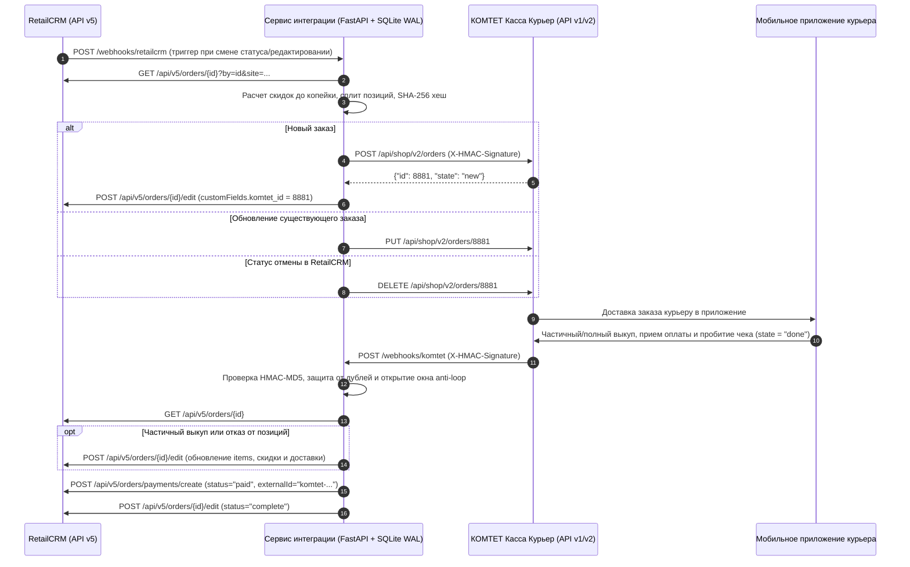

# Интеграция RetailCRM ↔ «КОМТЕТ Касса Курьер»


Production-ready сервис двусторонней синхронизации заказов курьерской доставки и онлайн-фискализации (54-ФЗ) между **RetailCRM (API v5)** и облачным сервисом **«КОМТЕТ Касса Курьер» (API v1 / v2)** с современной веб-панелью администрирования.

---

## Архитектура и поток данных



---

## Ключевые возможности

- **Прямой поток (`RetailCRM → КОМТЕТ Касса Курьер`)**:
  - Автоматическое создание, обновление (`PUT`) и отмена (`DELETE`) заказов доставки по триггерным статусам RetailCRM.
  - Полная поддержка протоколов **КОМТЕТ API v2** и **v1** (настраивается в веб-панели).
  - Автоматическое создание и запись идентификатора заказа КОМТЕТ в дополнительное поле заказа RetailCRM (`customFields.komtet_id`).
  - Восстановление связки по `customFields.komtet_id` без создания дублей даже при переносе базы данных.
- **Точная финансовая математика и 54-ФЗ**:
  - Поддержка всех ставок НДС (`22%`, `20%`, `10%`, `0%`, `Без НДС`, расчётные ставки `10/110`, `20/120`, `22/122`) и систем налогообложения (`ОСНО`, `УСН доход`, `УСН доход-расход`, `ЕСХН`, `Патент`).
  - Учёт массива `item.prices` из RetailCRM, ручных и процентных скидок, предоплат (`payments` + `prepaySum`) и автоматический сплит позиции на 2 строки при неделимой копейке (`price * quantity == total` до копейки).
- **Обратный поток (`КОМТЕТ Касса → RetailCRM`)**:
  - Сверка частичного выкупа и полного отказа от товаров с сохранением каталожных связей (`id`, `offer`, `initialPrice`, `vatRate`, `properties`, `delivery.code`) и пересчётом ручной скидки заказа под фактический фискальный чек.
  - Идемпотентное создание или закрытие оплаты в RetailCRM (`externalId="komtet-{id}"`, часовой пояс `Europe/Moscow`) и перевод заказа в финальный статус (`complete`).
- **Надёжность и безопасность**:
  - Криптографическая проверка `X-HMAC-Signature` (HMAC-MD5 от `METHOD + URL + BODY`) с поддержкой работы за TLS-терминирующим Reverse Proxy (`X-Forwarded-Proto`, `X-Forwarded-Host`).
  - Защита от бесконечных циклов (`anti-loop` окно), SHA-256 дедупликация неизменившихся заказов, in-process блокировки по `order_id`.
  - Экспоненциальный Retry/Backoff (`0.3s, 0.7s, 1.5s`) при `HTTP 429/502/503/504` и сетевых сбоях; возврат `HTTP 503` на вебхуках при временной недоступности внешних API для гарантированного повтора доставки.
  - SSRF-защита исходящих URL и защита админ-панели по `Authorization: Bearer <ADMIN_API_TOKEN>`.

---

## Быстрый старт (Docker Compose)

### 1. Подготовка конфигурации

Скопируйте пример файла окружения и заполните ваши ключи:

```bash
cp .env.example .env
```

Отредактируйте `.env`:

```dotenv
APP_ENV=production
APP_TIMEZONE=Europe/Moscow
APP_PORT=8080
PUBLIC_BASE_URL=https://sync.your-domain.ru
KOMTET_CALLBACK_URL=https://sync.your-domain.ru/webhooks/komtet

# Обязательные токены безопасности в production
ADMIN_API_TOKEN=сгенерируйте_длинный_случайный_токен_администратора
RETAILCRM_WEBHOOK_TOKEN=сгенерируйте_секретный_токен_для_триггера_retailcrm

# RetailCRM API v5
RETAILCRM_URL=https://your-shop.retailcrm.ru
RETAILCRM_API_KEY=ваш_ключ_retailcrm
RETAILCRM_DEFAULT_SITE=ваш_код_сайта

# КОМТЕТ Касса
KOMTET_BASE_URL=https://kassa.komtet.ru
KOMTET_SHOP_ID=ваш_shop_id
KOMTET_SECRET_KEY=ваш_secret_key
KOMTET_QUEUE_ID=12345
KOMTET_API_VERSION=v2
```

### 2. Запуск контейнеров

```bash
docker compose up -d --build
```

Проверьте состояние сервисов:

```bash
docker compose ps
curl http://127.0.0.1:8080/health
```

Веб-панель управления будет доступна локально на loopback-адресе `http://127.0.0.1:8080` (порт привязан строго к `127.0.0.1`, чтобы не открывать HTTP наружу в обход UFW), а после настройки внешнего Nginx — по `https://sync.your-domain.ru`.

### Хранение данных и резервное копирование (`komtet_data`)

База данных SQLite (`/app/data/integration.db` в WAL-режиме) хранится в Docker named volume **`komtet_data`**. Использование named volume гарантирует, что непривилегированный пользователь `appuser` внутри контейнера всегда имеет права на запись на Linux VPS без ручного `chown`.

Полезные команды обслуживания:

```bash
# Проверить расположение и метаданные volume
docker volume inspect komtet-retailcrm_komtet_data

# Горячий бэкап SQLite (через встроенный Python внутри запущенного контейнера)
docker compose exec -T backend python -c "import sqlite3; src=sqlite3.connect('/app/data/integration.db'); dst=sqlite3.connect('/tmp/backup.db'); src.backup(dst); dst.close(); src.close()"
docker compose cp backend:/tmp/backup.db ./integration-backup-$(date +%F).db
docker compose exec -T backend rm -f /tmp/backup.db
```

> Не используйте `docker compose down -v`, если не хотите удалить базу данных и сохранённые настройки.

---

## Настройка внешнего Nginx + Certbot (HTTPS на продакшн-VPS)

КОМТЕТ Касса подписывает обратные вебхуки заголовком `X-HMAC-Signature`, вычисляя HMAC-MD5 от полного внешнего HTTPS URL. Внешний Nginx на хосте должен передавать заголовки `Host`, `X-Forwarded-Proto` и `X-Forwarded-Host` (используйте `$http_host`, чтобы корректно сохранять нестандартные порты при наличии).

### 1. Создайте первичный HTTP-конфиг (до выпуска сертификата)

Создайте файл `/etc/nginx/sites-available/komtet-retailcrm`:

```nginx
server {
    listen 80;
    server_name sync.your-domain.ru;

    client_max_body_size 2m;

    location / {
        proxy_pass http://127.0.0.1:8080;
        proxy_http_version 1.1;
        proxy_set_header Host $http_host;
        proxy_set_header X-Real-IP $remote_addr;
        proxy_set_header X-Forwarded-For $proxy_add_x_forwarded_for;
        proxy_set_header X-Forwarded-Proto $scheme;
        proxy_set_header X-Forwarded-Host $http_host;
        proxy_connect_timeout 10s;
        proxy_send_timeout 90s;
        proxy_read_timeout 90s;
    }
}
```

Активируйте сайт и проверьте конфигурацию Nginx:

```bash
sudo ln -s /etc/nginx/sites-available/komtet-retailcrm /etc/nginx/sites-enabled/
sudo nginx -t && sudo systemctl reload nginx
```

### 2. Выпустите сертификат Let's Encrypt через Certbot

`certbot --nginx` автоматически выпустит сертификат, добавит `server` на порту `443 ssl` и настроит редирект с HTTP на HTTPS:

```bash
sudo apt update && sudo apt install -y nginx certbot python3-certbot-nginx
sudo certbot --nginx -d sync.your-domain.ru --redirect
```

После этого в секции `443 ssl` сохранятся все директивы `proxy_set_header` и увеличенный таймаут `proxy_read_timeout 90s;` (достаточный для ретраев внешних API).

---

## Пошаговая настройка интеграции

### Шаг 1. Инициализация в веб-панели
1. Откройте веб-панель `https://sync.your-domain.ru` и введите `ADMIN_API_TOKEN`.
2. На вкладке **«Подключение и параметры»** проверьте реквизиты RetailCRM и КОМТЕТ Кассы, выберите СНО, ставку НДС по умолчанию, укажите ИНН и адрес расчётов.
3. Нажмите **«Проверить подключение и инициализировать komtet_id»** — сервис проверит доступ к обоим API и автоматически создаст в RetailCRM дополнительное поле заказа `komtet_id` (если оно ещё не создано).
4. На вкладке **«Статусы и маппинг»** нажмите **«Обновить справочники из API»**, сопоставьте статусы заказов, курьеров, типы оплат и ставки НДС, после чего нажмите **«Сохранить маппинг и статусы»**.

### Шаг 2. Настройка триггера в RetailCRM
1. В RetailCRM перейдите в **Администрирование → Интеграция → Ключи доступа к API** и убедитесь, что вашему ключу выданы права на чтение/запись заказов (`orders`), справочников (`reference`) и пользовательских полей (`custom-fields`).
2. Перейдите в **Администрирование → Коммуникации → Триггеры** и создайте триггер на событие **«Изменение заказа»** (при необходимости укажите фильтр по статусам доставки/отмены).
3. Добавьте действие **«HTTP-запрос»**:
   - **URL:** `https://sync.your-domain.ru/webhooks/retailcrm`
   - **Метод:** `POST`
   - **Заголовки:** `X-Webhook-Token: <ваш_RETAILCRM_WEBHOOK_TOKEN>` (либо query-параметр `?token=<ваш_RETAILCRM_WEBHOOK_TOKEN>`)
   - **Тип содержимого:** `application/x-www-form-urlencoded` (или `application/json`)
   - **Параметры тела:**
     ```text
     order_id={{ order.id }}&site={{ order.site }}&event=order_edit
     ```

### Шаг 3. Настройка Callback URL в КОМТЕТ Кассе
1. В веб-панели интеграции на вкладке **«Подключение и параметры»** заполните поле **Публичный Callback URL**:
   ```text
   https://sync.your-domain.ru/webhooks/komtet
   ```
   Сервис автоматически передаёт этот `callback_url` в каждом создаваемом и обновляемом заказе КОМТЕТ Кассы.
2. Дополнительно рекомендуется указать тот же URL `https://sync.your-domain.ru/webhooks/komtet` в настройках магазина в личном кабинете `https://kassa.komtet.ru`.

---

## Переменные окружения

| Переменная | По умолчанию | Описание |
|---|---|---|
| `APP_ENV` | `production` (Docker / `.env.example`), `development` (локально) | Окружение (`development`, `staging`, `production`, `test`). В `production` токены обязательны, Swagger/OpenAPI и dev CORS отключены |
| `APP_TIMEZONE` | `Europe/Moscow` | Часовой пояс для `paidAt` оплат и дат доставки (работает через `ZoneInfo` + `tzdata`) |
| `APP_PORT` | `8080` | Локальный порт `127.0.0.1:${APP_PORT}:80` контейнера `frontend` (Nginx) |
| `LOG_LEVEL` | `INFO` | Уровень логирования бэкенда (`DEBUG`, `INFO`, `WARNING`, `ERROR`) |
| `LOG_RETENTION_DAYS` | `30` | Срок хранения записей `sync_logs` в днях (батчевая очистка; `<= 0` отключает фоновую очистку) |
| `HTTP_TIMEOUT_SECONDS` | `15.0` | Таймаут исходящих HTTP-запросов к RetailCRM и КОМТЕТ Кассе (в секундах) |
| `CORS_ORIGINS` | `[]` в `production`, `localhost` в `dev` | Явный список разрешённых CORS-origins (JSON-массив или список через запятую) |
| `PUBLIC_BASE_URL` | `""` | Базовый публичный HTTPS URL сервиса |
| `KOMTET_CALLBACK_URL` | `""` | Полный URL для обратных вебхуков КОМТЕТ (`<PUBLIC_BASE_URL>/webhooks/komtet`) |
| `ADMIN_API_TOKEN` | `""` | Bearer-токен для доступа к веб-панели и `/api/v1/*` (в `production` обязателен, fail-closed) |
| `RETAILCRM_WEBHOOK_TOKEN` | `""` | Секретный токен для верификации входящих триггеров `/webhooks/retailcrm` (в `production` обязателен, fail-closed) |
| `RETAILCRM_URL` | `""` | URL аккаунта RetailCRM (`https://your-shop.retailcrm.ru`) |
| `RETAILCRM_API_KEY` | `""` | API-ключ RetailCRM API v5 |
| `RETAILCRM_DEFAULT_SITE` | `""` | Символьный код сайта (магазина) в RetailCRM по умолчанию |
| `KOMTET_BASE_URL` | `https://kassa.komtet.ru` | Базовый URL API КОМТЕТ Кассы |
| `KOMTET_SHOP_ID` | `""` | Идентификатор магазина (`Shop ID`) в КОМТЕТ Кассе |
| `KOMTET_SECRET_KEY` | `""` | Секретный ключ магазина для подписи `X-HMAC-Signature` |
| `KOMTET_QUEUE_ID` | `None` | Числовой ID очереди (кассы) в КОМТЕТ Кассе |
| `KOMTET_API_VERSION` | `v2` | Версия API заказов КОМТЕТ (`v2` или `v1`) |
| `DATABASE_URL` | `sqlite+aiosqlite:////app/data/integration.db` (Docker) | Строка подключения SQLAlchemy 2.0 (в Docker хранится в volume `komtet_data`) |

---

## Эндпоинты REST API

| Метод и путь | Авторизация | Назначение |
|---|---|---|
| `GET /health` | Публичный | Liveness-проверка контейнера |
| `GET /api/v1/health` | Публичный | Readiness-проверка БД и флагов конфигурации |
| `GET/POST /webhooks/retailcrm` | `X-Webhook-Token` / `?token=` | Прием триггерных вебхуков из RetailCRM |
| `POST /webhooks/komtet` | `X-HMAC-Signature` | Прием обратных вебхуков фискализации из КОМТЕТ Кассы |
| `GET /api/v1/settings` | `Bearer <ADMIN_API_TOKEN>` | Получение текущих настроек (секреты маскируются `****XXXX`) |
| `PUT /api/v1/settings` | `Bearer <ADMIN_API_TOKEN>` | Обновление настроек с защитой от SSRF |
| `POST /api/v1/settings/test-connection` | `Bearer <ADMIN_API_TOKEN>` | Проверка подключения к RetailCRM/КОМТЕТ и создание поля `komtet_id` |
| `GET /api/v1/dictionaries` | `Bearer <ADMIN_API_TOKEN>` | Загрузка живых справочников статусов, курьеров, типов оплат и очередей |
| `GET /api/v1/mappings` | `Bearer <ADMIN_API_TOKEN>` | Получение таблиц маппинга |
| `PUT /api/v1/mappings` | `Bearer <ADMIN_API_TOKEN>` | Сохранение маппинга курьеров, типов оплат и ставок НДС |
| `GET /api/v1/orders-sync` | `Bearer <ADMIN_API_TOKEN>` | Пагинированный список синхронизированных заказов |
| `POST /api/v1/sync/manual/{order_id}` | `Bearer <ADMIN_API_TOKEN>` | Ручная отправка заказа из RetailCRM в КОМТЕТ Кассу |
| `GET /api/v1/logs` | `Bearer <ADMIN_API_TOKEN>` | Пагинированный журнал синхронизации с фильтрами по статусу, направлению и `order_id` |

---

## Локальная разработка и запуск тестов

```bash
# 1. Запуск тестов бэкенда (в активированном виртуальном окружении или в контейнере)
python -m pytest backend/tests/ -v
# или через Docker Compose:
docker compose run --rm --no-deps backend pytest -v

# 2. Сборка фронтенда (TypeScript + Vite)
cd frontend
npm install
npm run build
```

## Лицензия

Проект распространяется под лицензией [MIT](LICENSE).
